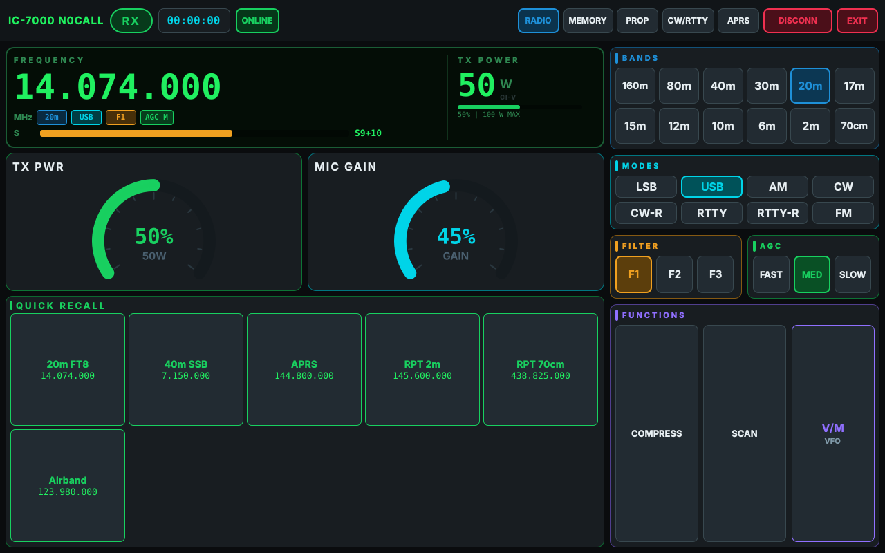
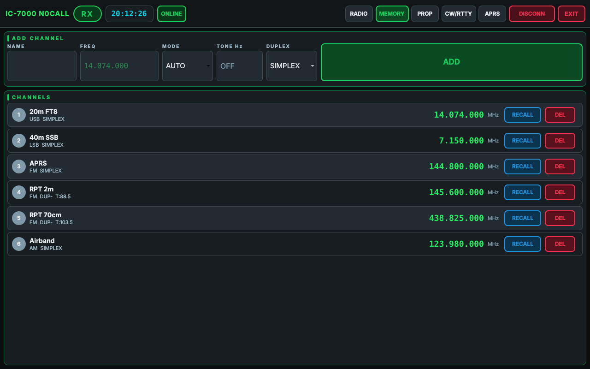
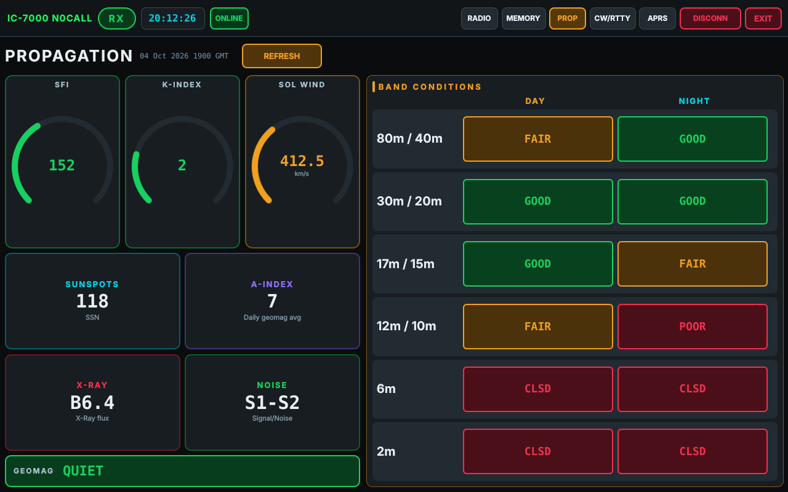
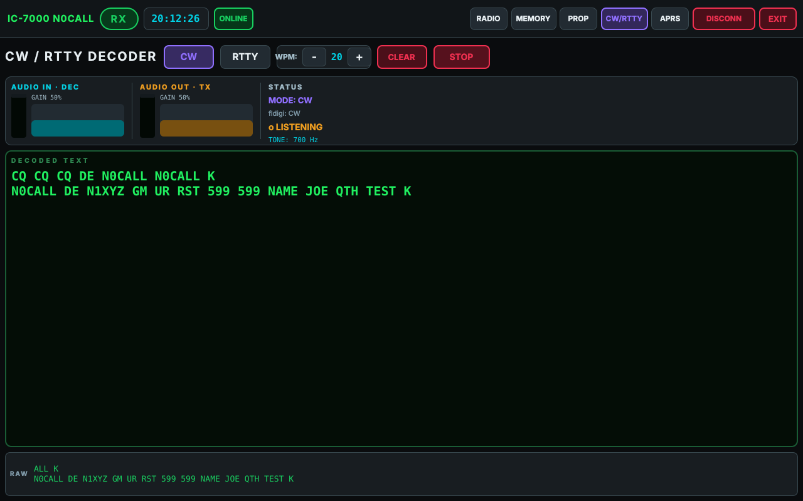
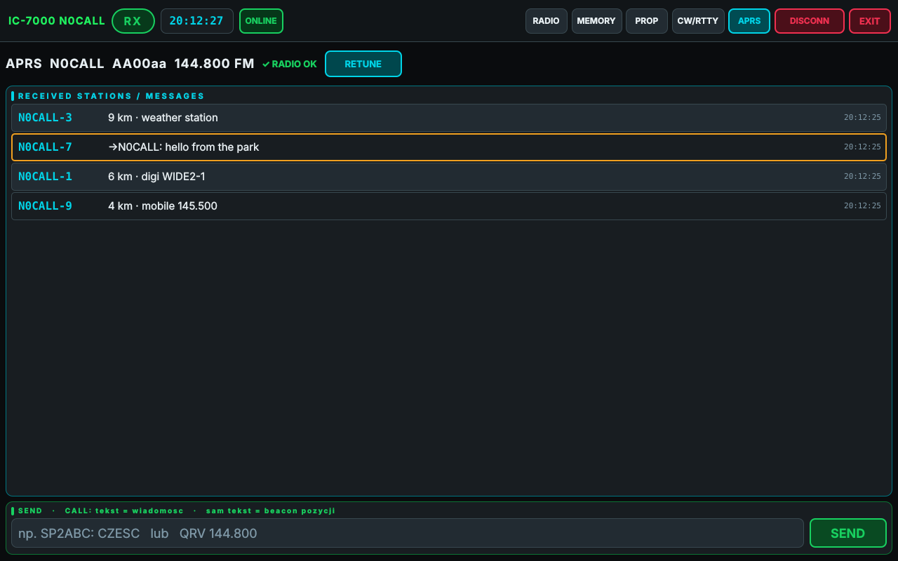

# IC7000 Controller

A full-screen touch control panel for the **Icom IC-7000** transceiver, written in Python (PyQt6 + QML).
It talks to the radio over **CI-V** and bundles the things a small shack computer is usually used for:
band/mode control, memories, HF propagation, a CW/RTTY decoder (via fldigi) and APRS on 2 m (via Dire Wolf).

It is designed for a single-board computer with a touchscreen sitting next to the radio
(e.g. a Raspberry Pi / Orange Pi with a 7–10" display), but it runs on any Linux desktop.



## Features

**Radio control (CI-V)**
- Large frequency display with band, mode, filter and AGC indicators
- S-meter in receive, power output and SWR while transmitting
- One-tap band buttons (160 m – 70 cm) and modes (LSB, USB, AM, CW, CW-R, RTTY, RTTY-R, FM)
- Filter (FIL1–3), AGC (fast / mid / slow), speech compressor, scan and VFO/memory switching
- Touch arc gauges for **TX power** and **mic gain**; taps outside the ring are ignored, so a stray touch cannot jump to 100 %
- Band and maximum power follow the radio's tuning knob (100 W HF/6 m, 50 W 2 m, 35 W 70 cm)
- State is read back from the radio, so the panel and the front panel stay in sync

**Memories**
- Channel list stored in `memories.json`: name, frequency, mode, duplex direction and CTCSS tone
- Recall sets frequency, mode, duplex and tone in one tap; quick-recall grid on the main page
- CTCSS tones are validated against the 50 standard tones
- Flexible frequency entry: `14.074`, `7074` (kHz), `145.500.000`, `433`, `7.074 MHz`

**Propagation**
- Solar flux, sunspots, K/A index, X-ray, solar wind, geomagnetic field and noise from [hamqsl.com](https://www.hamqsl.com/solar.html)
- Day/night band conditions for HF, plus E-skip for 6 m and 2 m; cached for 15 minutes

**CW / RTTY decoder**
- Uses [fldigi](http://www.w1hkj.com/) over XML-RPC as the decoder
- Mode switching, WPM, clear, and audio input/output level controls (ALSA `amixer`)

**APRS (144.800 MHz)**
- Receives frames from [Dire Wolf](https://github.com/wb2osz/direwolf) over KISS TCP
- Shows received stations with distance from your QTH, plus messages
- Sends position beacons or APRS messages (`CALL: text`), and acknowledges messages addressed to you
- PTT is keyed by the app over CI-V; transmission is refused unless the radio is on 144.800 MHz FM

**Touch-first UI**
- Built-in on-screen keyboard (no system keyboard needed), including lowercase and `/ - : _` for serial port names
- Status messages appear as short pop-ups
- Runs full screen with a hidden cursor; press `Esc` to drop to a window

| | |
|---|---|
|  |  |
|  |  |

## Requirements

- Linux (tested on Debian-based systems; the serial port is opened in exclusive mode)
- Python 3.9+
- PyQt6 and pyserial
- An IC-7000 CI-V interface (CT-17 or a USB CI-V cable)
- Optional:
  - fldigi, for the CW/RTTY decoder
  - Dire Wolf, for APRS
  - A USB sound card connected to the radio's data/mic port, for both
  - `alsa-utils` (`amixer`, `arecord`, `aplay`) for the audio level controls

## Installation

```bash
git clone https://github.com/myshak1/IC7000-Controller.git
cd IC7000-Controller
python3 -m pip install -r requirements.txt
cp config.example.json config.json
nano config.json          # set your callsign, locator and QTH coordinates
python3 main.py
```

On Debian / Raspberry Pi OS you can use the distribution packages instead of pip
(`python3-pyqt6`, `python3-pyqt6.qtquick`, `python3-serial` and the Qt 6 QML modules for Qt Quick Controls).

## Configuration

Station data lives in `config.json` (not tracked by git). All keys are optional; missing ones fall back to the defaults in `config.py`.

| Key | Meaning |
|---|---|
| `callsign` | Your callsign. APRS transmit is disabled while it is `N0CALL`. |
| `locator` | Maidenhead locator, shown in the UI. |
| `lat`, `lon` | QTH coordinates in decimal degrees, used for APRS beacons and distances. |
| `aprs_symbol_table`, `aprs_symbol` | APRS symbol (default `/-` = house). |
| `aprs_path` | Digipeater path, default `["WIDE1-1", "WIDE2-1"]`. |
| `kiss_host`, `kiss_port` | Dire Wolf KISS TCP endpoint (default `127.0.0.1:8001`). |
| `fldigi_url` | fldigi XML-RPC endpoint (default `http://127.0.0.1:7362`). |
| `direwolf_conf`, `direwolf_log` | Dire Wolf config used for autostart, and its log file. |

Set `IC7000_CONFIG=/path/to/config.json` to use a file somewhere else.

### Radio settings

In the IC-7000 set menu, set **CI-V Address** to `70h` (the default) and pick a **CI-V Baud Rate** (9600 is a good choice). Enter the same values in the app's **CONNECT** dialog. The port list shows detected serial ports, and you can also type a path such as `/dev/ttyUSB0`.

Repeater offsets are taken from the radio's own duplex offset setting. A memory only stores the direction (DUP+ / DUP−).

### Dire Wolf (APRS)

`main.py` starts Dire Wolf automatically with `~/direwolf.conf` if it is not already running, and writes its output to `~/direwolf.log`.
The app keys the radio itself over CI-V, so Dire Wolf must **not** use the serial port for PTT. It needs to run with `FULLDUP ON`, so it transmits immediately instead of waiting for a clear channel after the app has already keyed up.
A starting point is in [`docs/direwolf.conf.example`](docs/direwolf.conf.example).

### fldigi (CW/RTTY)

Start fldigi on the same sound card and enable XML-RPC (it listens on port 7362 by default).
Dire Wolf and fldigi cannot both open the same ALSA `hw:` capture device at once. Use `dsnoop`, PulseAudio or PipeWire if you want both running together.

## Project layout

| File | Purpose |
|---|---|
| `main.py` | Entry point: starts Dire Wolf, loads the QML UI, shuts everything down cleanly (PTT off) |
| `main.qml` | The touch UI (Qt Quick) |
| `backend.py` | Qt backend: radio polling, memories, propagation, APRS, fldigi, audio |
| `civ.py` | Pure-Python CI-V driver for the IC-7000 (no Qt dependency) |
| `config.py` | Loads station configuration from `config.json` |
| `tests/test_civ.py` | Tests for helpers, APRS encoding and the CI-V driver against a simulated radio |

## Tests

```bash
python3 tests/test_civ.py
```

The CI-V test runs against a simulated IC-7000 on a pseudo-terminal, including the command echo you get on a real CI-V bus. No radio is needed.

## Safety notes

This software keys a transmitter. Before leaving it unattended:
- Enable the radio's time-out timer.
- Check your PTT path. The app releases PTT on every transmission, on disconnect and on exit, retries if the radio does not confirm, and shows a warning if it still cannot release.
- APRS transmit only happens on 144.800 MHz FM with a real callsign configured.

You are responsible for operating within your licence conditions.

## Notes

- The UI labels are in English. Some status pop-ups and code comments are in Polish.
- Tested against a simulated radio. Please open an issue if a CI-V command behaves differently on your IC-7000 firmware.

## License

MIT, see [LICENSE](LICENSE).

73!
